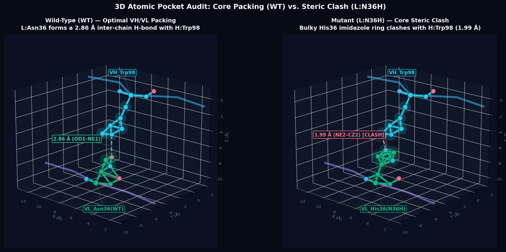
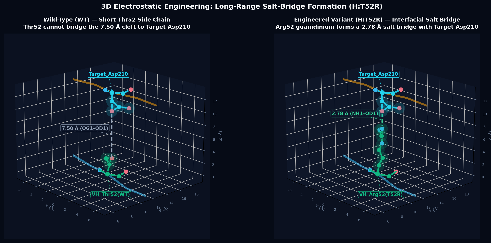
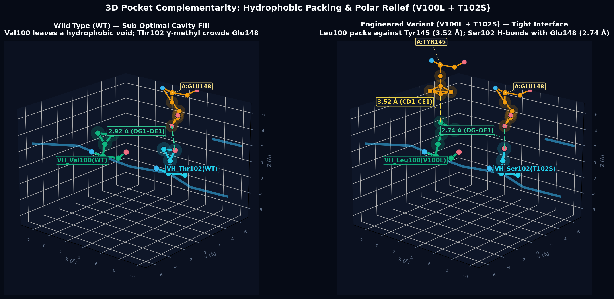

# biomolecular-3d-viewer

**Publication-grade 3D atomic close-up renderer (`.png`), standalone interactive `3Dmol.js` Shared 3D Canvas builder (`.html`), and inter-chain contact/clash inspector for AI coding agents.**

[](https://github.com/sologuy/biomolecular-3d-viewer/actions/workflows/ci.yml)
[](LICENSE)
[](#installation)
[](#3-viewer--standalone-interactive-3d-canvas)
[](#supported-ai-agent-harnesses)
[](#installation)

When AI agents assist with protein engineering, antibody-antigen interface optimization, peptide design, or structural bioinformatics, 1D sequences and raw energy tables are not enough. Both the human researcher and the agent need **direct 3D structural grounding**—the ability to inspect exact heavy-atom distances, verify whether a mutation introduces a steric clash or a new salt bridge, render high-contrast 3D pocket figures for reports, and spin the complex interactively in a browser.

Inspired by the **Biomolecular Structure Viewer (Shared 3D Canvas)** paradigm highlighted in Google DeepMind's *Accelerating the search for antimicrobial peptides with Google Antigravity*, `biomolecular-3d-viewer` packages a deterministic Python CLI (`scripts/mol3d_canvas.py`) and a portable agent skill (`SKILL.md`) that work out of the box across **Claude Code**, **OpenAI Codex CLI**, **Google Antigravity**, **GitHub Copilot CLI**, **DeepSeek Harness (DSH)**, and **Muse Code**.

---

## Visual Showcase

### 1. Side-by-Side 3D Steric Clash Audit (`Wild-Type` vs. `Mutant`)
Automatically detects inter-chain heavy-atom contacts, renders translucent van der Waals halos, and flags steric clashes (`< 2.45 Å`) in red with non-overlapping 3D leader-line badges:



### 2. Long-Range Electrostatic Salt-Bridge Verification
Directly compares the inter-atomic gap across a binding cleft (`7.50 Å` in Wild-Type vs. a `2.78 Å` bidentate guanidinium–carboxylate salt bridge in the engineered variant):



### 3. Hydrophobic Cavity Packing & Polar Relief
Simultaneously tracks multiple focal residues (`Chain:ResNo:Label`) and their nearest non-local contacting partners (`≤ 4.2 Å`) with outward radial label repulsion (`computed_zorder=False`):



---

## Key Features

- **`inspect` — Deterministic Interface & Clash Audit**: Parses `.pdb` and `.cif`/`.mmcif` structures via `Bio.PDB`, summarizes chain boundaries, and computes exact heavy-atom distances across any chain interface (e.g., `--interface "H,L:A"`), classifying contacts into:
  - `steric_clash` (`< 2.40 Å`)
  - `polar_hbond_or_saltbridge` (`≤ 3.50 Å` between `N`/`O` heavy atoms)
  - `nonpolar_or_vdw_contact` (`≤ cutoff`)
- **`closeup` — 200 DPI Dark-Theme 3D Atomic Figures (`.png`)**: Renders single-panel pocket close-ups or dual-panel side-by-side comparisons (`--pdb1` vs. `--pdb2`). Combines local Cα backbone traces, CPK ball-and-stick side chains, translucent van der Waals spheres, color-coded dashed distance lines (`Å`), and collision-free 3D callout badges.
- **`viewer` — Zero-CORS Standalone `3Dmol.js` Shared 3D Canvas (`.html`)**: Generates a single self-contained HTML file that embeds the interface coordinate strings directly inside JavaScript (`PDB_MODELS`) and builds one-click camera preset buttons for the full complex and every focal pocket. Opens directly via `file://` in any desktop browser without a local web server.
- **Single-Source Multi-Harness Skill**: One canonical installation in `~/.agents/skills/biomolecular-3d-viewer` natively powers six major AI coding harnesses.

---

## Supported AI Agent Harnesses

| Agent Harness | Discovery Path | Mechanism |
| :--- | :--- | :--- |
| **Google Antigravity (`agy`)** | `~/.agents/skills/biomolecular-3d-viewer` | Native discovery from `~/.agents/skills/` |
| **GitHub Copilot CLI (`copilot`)** | `~/.agents/skills/biomolecular-3d-viewer` | Native discovery from `~/.agents/skills/` |
| **DeepSeek Harness (`dsh`)** | `~/.agents/skills/biomolecular-3d-viewer` | Native live-watch via `@deepseek-ai/dsh-skill-filesystem` |
| **Muse Code (`muse`)** | `~/.agents/skills/biomolecular-3d-viewer` | Native user-scope skill discovery (`activation: on`) |
| **Claude Code (`claude`)** | `~/.claude/skills/biomolecular-3d-viewer` | Symlinked to `~/.agents/skills/biomolecular-3d-viewer` by `install.sh` |
| **OpenAI Codex CLI (`codex`)** | `~/.codex/skills/biomolecular-3d-viewer` | Symlinked to `~/.agents/skills/biomolecular-3d-viewer` by `install.sh` |

---

## Installation

### Prerequisites

- **Python ≥ 3.9**
- Scientific Python stack (`biopython`, `numpy`, `matplotlib`):
  ```bash
  pip install biopython numpy matplotlib
  ```

### Option A: Clone Directly into `~/.agents/skills/` (Recommended)

```bash
git clone https://github.com/sologuy/biomolecular-3d-viewer.git \
  ~/.agents/skills/biomolecular-3d-viewer

cd ~/.agents/skills/biomolecular-3d-viewer
pip install -r requirements.txt
./scripts/install.sh
```

### Option B: Clone Anywhere & Run `install.sh`

```bash
git clone https://github.com/sologuy/biomolecular-3d-viewer.git
cd biomolecular-3d-viewer
pip install -r requirements.txt
./scripts/install.sh
```

`./scripts/install.sh` performs preflight checks on all target directories before writing, refuses to overwrite non-symlink directories, and links the skill into `~/.agents/skills/`, `~/.claude/skills/`, and `~/.codex/skills/` (plus `~/.hermes/skills/` when `~/.hermes` is present).

---

## Using the Skill in Your AI Agent

Once installed, simply ask your coding agent in natural language:

```text
Inspect the binding interface between chains H,L and chain A in examples/mutant_complex.pdb,
check for any steric clashes or salt bridges, render a side-by-side 3D close-up PNG comparing
examples/wt_complex.pdb vs examples/mutant_complex.pdb at L:36 and H:98, and build an
interactive 3D HTML viewer for the key mutations.
```

Or invoke the skill explicitly in harnesses that support slash commands:

```text
/biomolecular-3d-viewer Compare the 3D pocket geometry around H:52 and A:210 between wt_complex.pdb and mutant_complex.pdb
```

---

## CLI Reference (`scripts/mol3d_canvas.py`)

You can also run `mol3d_canvas.py` directly from the terminal or inside automated structural biology pipelines.

### 1. `inspect` — Parse Chains & Inter-Chain Atomic Contacts

```bash
python3 scripts/mol3d_canvas.py inspect \
  examples/mutant_complex.pdb \
  --interface "H,L:A" \
  --cutoff 4.5 \
  --top 20 \
  --json-out /tmp/contacts.json
```

**Arguments (`inspect`):**

| Flag | Default | Description |
| :--- | :--- | :--- |
| `pdb` | *(required)* | Path to input `.pdb`, `.cif`, or `.mmcif` coordinate file |
| `--interface` | First chain vs. rest | Chain group pair separated by `:`, e.g., `"H,L:A"` or `"A:B,C"` |
| `--cutoff` | `4.5` | Heavy-atom distance cutoff in Ångströms (`Å`) |
| `--top` | `40` | Maximum number of closest inter-chain contacts to output |
| `--json-out` | `None` | Optional path to save the structured JSON report |

**Sample JSON Output:**

```json
{
  "pdb": "/path/to/examples/mutant_complex.pdb",
  "chains": [
    { "chain": "H", "length": 20, "first_res": "VAL48", "last_res": "TYR105" },
    { "chain": "L", "length": 9, "first_res": "TYR32", "last_res": "PRO40" },
    { "chain": "A", "length": 17, "first_res": "ASN142", "last_res": "ASN214" }
  ],
  "interface_groups": { "group1": ["H", "L"], "group2": ["A"] },
  "cutoff_A": 4.5,
  "total_contacts": 3,
  "top_contacts": [
    {
      "dist_A": 2.74,
      "type": "polar_hbond_or_saltbridge",
      "res1": "H:SER102",
      "atom1": "OG",
      "res2": "A:GLU148",
      "atom2": "OE1"
    },
    {
      "dist_A": 2.78,
      "type": "polar_hbond_or_saltbridge",
      "res1": "H:ARG52",
      "atom1": "NH1",
      "res2": "A:ASP210",
      "atom2": "OD1"
    },
    {
      "dist_A": 3.52,
      "type": "nonpolar_or_vdw_contact",
      "res1": "H:LEU100",
      "atom1": "CD1",
      "res2": "A:TYR145",
      "atom2": "CE1"
    }
  ]
}
```

---

### 2. `closeup` — Render 200 DPI 3D Atomic Pocket Figures (`.png`)

```bash
python3 scripts/mol3d_canvas.py closeup \
  --pdb1 examples/wt_complex.pdb \
  --pdb2 examples/mutant_complex.pdb \
  --focus "L:36:VL_Asn36(WT),H:98:VH_Trp98" \
  --focus2 "L:36:VL_His36(N36H),H:98:VH_Trp98" \
  --suptitle "3D Atomic Pocket Audit: Core Packing (WT) vs. Steric Clash (L:N36H)" \
  --title1 "Wild-Type (WT) — Optimal VH/VL Packing" \
  --subtitle1 "L:Asn36 forms a 2.86 Å inter-chain H-bond with H:Trp98" \
  --title2 "Mutant (L:N36H) — Core Steric Clash" \
  --subtitle2 "Bulky His36 imidazole ring clashes with H:Trp98 (1.99 Å)" \
  --radius 6.2 \
  --elev 18 --azim -48 \
  --out assets/wt_vs_mutant_clash_3d.png
```

**Arguments (`closeup`):**

| Flag | Default | Description |
| :--- | :--- | :--- |
| `--pdb1` | *(required)* | Primary (or Wild-Type) `.pdb`/`.cif` file path |
| `--pdb2` | `None` | Optional second (Mutant/Variant) `.pdb`/`.cif` file for side-by-side comparison |
| `--focus` | *(required)* | Comma-separated focal residue tokens `Chain:ResNo[:CustomLabel]` for `--pdb1` |
| `--focus2` | Same as `--focus` | Optional focal residue tokens for `--pdb2` when residue labels differ |
| `--out` | *(required)* | Output `.png` path (rendered at 200 DPI) |
| `--suptitle` | `None` | Overall figure super-title |
| `--title1` / `--subtitle1` | Basename / `""` | Title and subtitle for the primary/left 3D panel |
| `--title2` / `--subtitle2` | Basename / `""` | Title and subtitle for the secondary/right 3D panel |
| `--radius` | `7.2` | 3D bounding-box half-width in Ångströms (`Å`) around focal centroid |
| `--elev` / `--azim` | `20.0` / `-45.0` | 3D camera elevation and azimuth angles in degrees |

**Color Semantics in `closeup`:**
- **Focal Residues**: Emerald (`#10B981`) and Cyan (`#22D3EE`) carbon skeletons with CPK heteroatoms (`N` blue `#38BDF8`, `O` coral `#FB7185`, `S` yellow `#FACC15`) and translucent van der Waals spheres.
- **Auto-Detected Neighboring Residues (`≤ 4.2 Å`)**: Amber (`#F59E0B`) ball-and-stick side chains.
- **Dashed Inter-Atomic Distance Lines**:
  - Coral Red (`#FB7185` + `[CLASH]` tag): Steric clash (`< 2.45 Å`)
  - Mint Green (`#34D399`): Hydrogen bond or salt bridge (`2.45–3.50 Å`)
  - Warm Yellow (`#FDE047`): Favorable van der Waals contact (`3.51–4.50 Å`)
  - Slate (`#94A3B8`): Long-range reference gap (`4.51–8.50 Å`)

---

### 3. `viewer` — Build Standalone Interactive `3Dmol.js` Canvas (`.html`)

```bash
python3 scripts/mol3d_canvas.py viewer \
  --pdb "Engineered_Variant=examples/mutant_complex.pdb" \
  --pdb "Wild_Type=examples/wt_complex.pdb" \
  --focus "H:52:VH_Arg52,H:100:VH_Leu100,H:102:VH_Ser102,L:36:VL_His36" \
  --title "Fab–Target Complex — Biomolecular 3D Viewer" \
  --out examples/demo_interactive_viewer.html \
  --open
```

**Arguments (`viewer`):**

| Flag | Default | Description |
| :--- | :--- | :--- |
| `--pdb` | *(required, repeatable)* | Model entry in `Label=/path/to/file.pdb` or `/path/to/file.pdb` format |
| `--focus` | `""` | Comma-separated focal residues `Chain:ResNo[:Label]`; auto-generates pocket camera views |
| `--title` | `"Biomolecular 3D Structure Viewer"` | Sidebar header and HTML page title |
| `--subtitle` | Auto-generated | Sidebar subtitle HTML string |
| `--cutoff` | `16.0` | Distance cutoff (`Å`) around primary chains when embedding coordinates |
| `--out` | *(required)* | Output self-contained `.html` file path |
| `--open` | `False` | Automatically open the generated HTML viewer in the default desktop browser |

---

## Repository Layout

```text
biomolecular-3d-viewer/
├── SKILL.md                          # Portable multi-harness Agent Skill specification
├── README.md                         # English documentation, showcase & CLI reference
├── CONTRIBUTING.md                   # Architecture boundaries & verification checklist
├── LICENSE                           # MIT License
├── requirements.txt                  # Python dependencies (biopython, numpy, matplotlib)
├── scripts/
│   ├── mol3d_canvas.py               # Core CLI (inspect / closeup / viewer)
│   ├── install.sh                    # Safe, idempotent multi-harness symlink installer
│   ├── install-check.sh              # Isolated installer test matrix
│   └── dryrun.sh                     # End-to-end functional test suite
├── examples/
│   ├── wt_complex.pdb                # Public benchmark Wild-Type 3-chain complex (H, L, A)
│   ├── mutant_complex.pdb            # Public benchmark Variant complex (T52R, V100L, T102S, N36H)
│   ├── demo_interactive_viewer.html  # Pre-built self-contained 3Dmol.js interactive canvas
│   └── run_demo.sh                   # Reproduces all showcase PNGs and HTML viewer
└── assets/
    ├── wt_vs_mutant_clash_3d.png     # Showcase 1: VH/VL core packing vs. N36H clash
    ├── interface_salt_bridge_3d.png  # Showcase 2: T52R long-range salt bridge
    └── cdr_pocket_packing_3d.png     # Showcase 3: V100L + T102S pocket complementarity
```

---

## Verification & Testing

Run the full verification suite locally without touching your existing agent directories:

```bash
# 1. Run end-to-end CLI tests (inspect JSON, single/dual 3D PNGs, standalone HTML viewer)
./scripts/dryrun.sh

# 2. Run isolated multi-harness installation & conflict-protection tests
./scripts/install-check.sh

# 3. Regenerate all showcase figures and the demo interactive viewer
./examples/run_demo.sh
```

---

## License

Released under the [MIT License](LICENSE). Copyright © 2026 [sologuy](https://github.com/sologuy).
